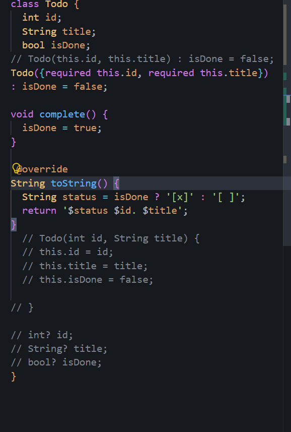
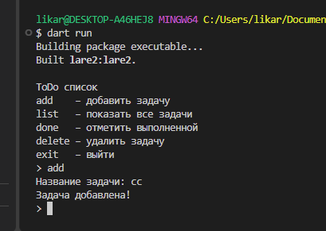
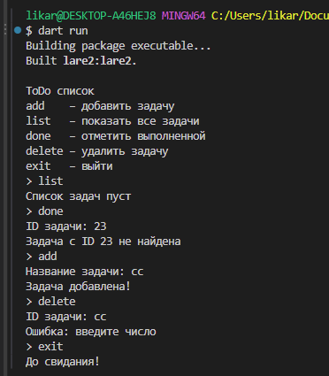
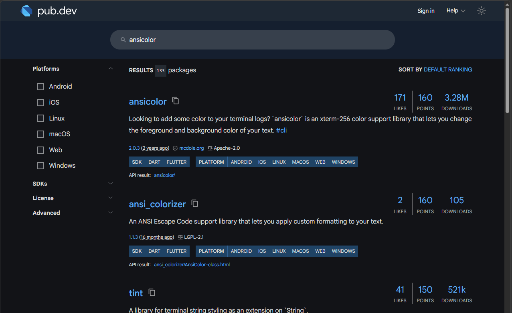

# Лаба №2. Классы и объекты в Dart

консольное ToDo-приложение на языке dart, где можно добавлять задачи, смотреть их список, отмечать выполненными и удалять.

## Автор
Резник Анжелика Ильинична, группа ИСП-242

## Запуск
1. Клонировать репозиторий: `git clone https://github.com/Anzhela2014/Dart_Lab2`
2. Перейти в папку: `cd Dart_Lab2`
3. Установить зависимости: `dart pub get`
4. Запустить: `dart run`

## Что изучили
* как объявлять классы, поля и методы в dart
* как работают конструкторы с именованными параметрами (required) и списком инициализации
* как переопределять метод `toString()` с помощью `@override`

## Скриншоты работы

## Ответы на вопросы

1. **В чём разница между полем класса и обычной переменной в функции?**  
   обычная переменная создаётся внутри функции и пропадает сразу как только функция заканчивает работу. A поле класса принадлежит самому объекту и хранит его данные всё время, пока этот объект живёт в программе

2. **Что такое конструктор и зачем он нужен?**  
   конструктор - это специальный метод с таким же названием, как у класса, который сам вызывается при создании нового объекта. Oн нужен, чтобы сразу записать начальные значения во все нужные поля объекта

3. **Зачем нужен @override перед toString()? Что будет если его убрать?**  
   `@override` показывает, что мы специально переписываем стандартный метод `toString()` родительского класса `Object`, и заставляет dart проверить, правильно ли мы написали имя и параметры. если его убрать, программа всё равно запустится, но если случайно ошибиться в названии метода, dart не предупредит об ошибке, и при выводе будет писаться обычное `Instance of 'Todo'`.

4. **Чем статическое поле `static int _counter` отличается от обычного поля? Сколько копий этого поля существует в программе?**  
   обычное поле создаётся отдельно для каждого объекта (у каждой задачи свой id и свой title), а статическое поле принадлежит всему классу сразу. во всей программе существует только одна общая копия этого поля, поэтому через него удобно считать сквозной номер для всех новых задач

5. **Что означает нижнее подчёркивание в `_counter`?**  
   нижнее подчёркивание в начале названия делает поле приватным — в dart это значит, что к `_counter` можно обращаться только внутри того же файла (lib/todo.dart), а из других файлов оно недоступно